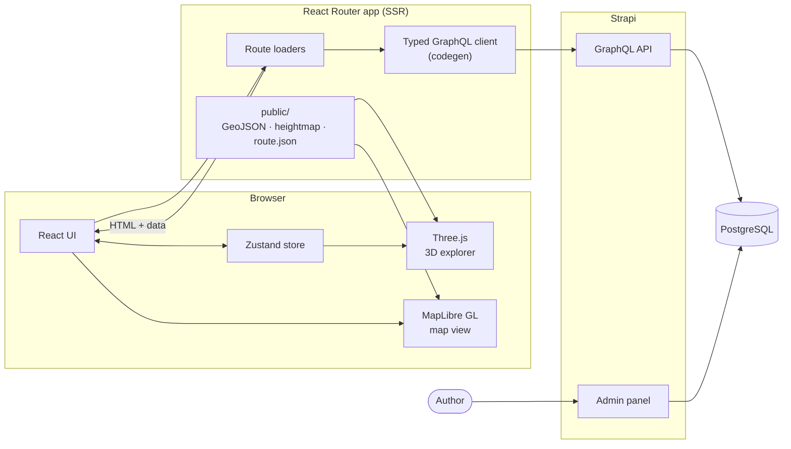
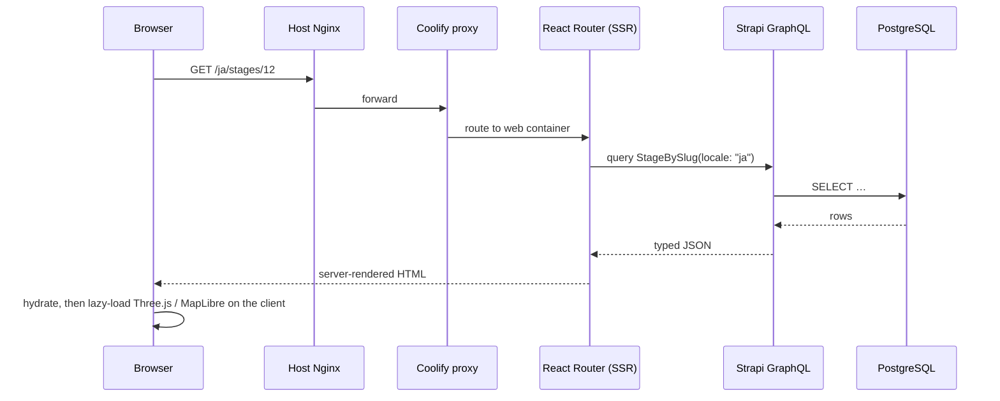
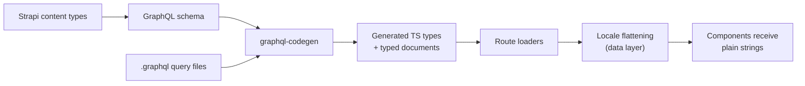
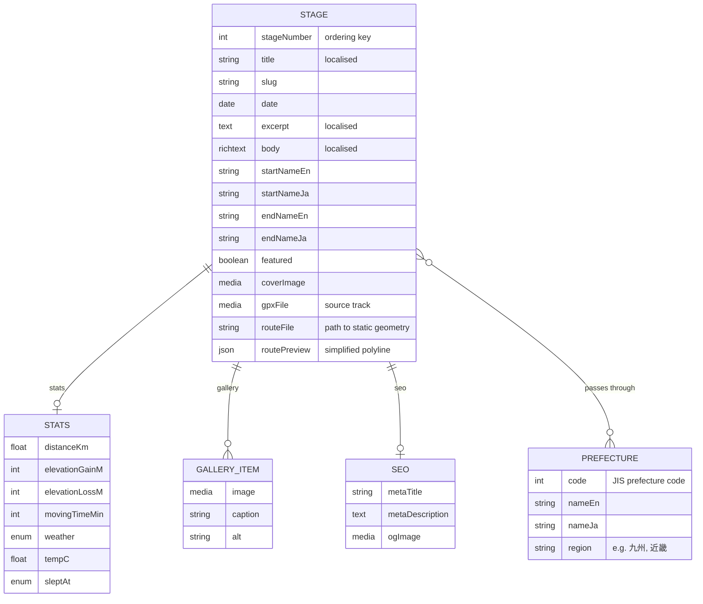
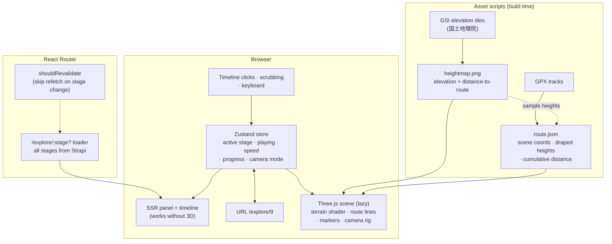
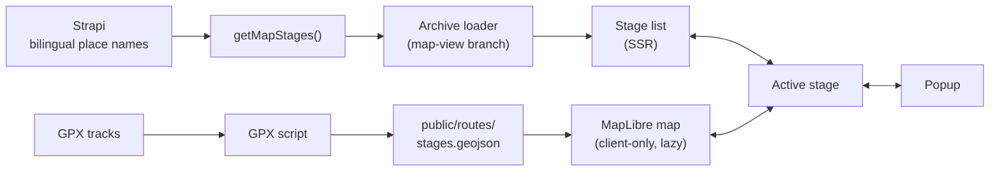
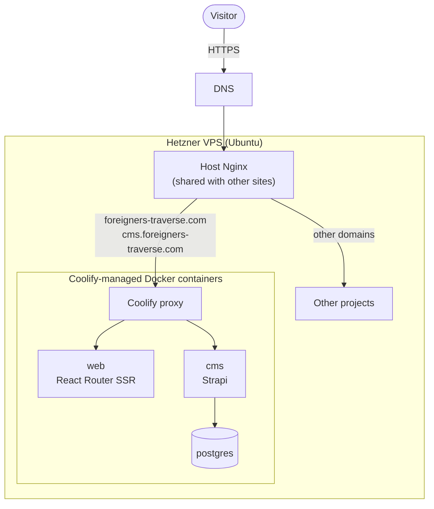
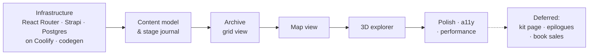

# 外人縦断 · Foreigners Traverse

**A bilingual (English / 日本語) journal of a solo bicycle ride across Japan, with an interactive 3D route explorer, a map archive, and a headless CMS behind it.**

🌐 **Live:** [foreigners-traverse.com](https://foreigners-traverse.com)
&nbsp;·&nbsp; 🛠 **CMS:** `cms.foreigners-traverse.com` (admin only)

<!-- TODO: add a hero screenshot or GIF of the 3D explorer -->
<!--  -->

---

## Contents

- [About the project](#about-the-project)
- [Features](#features)
- [Tech stack](#tech-stack)
- [Architecture](#architecture)
- [Content model](#content-model)
- [Bilingual design](#bilingual-design)
- [3D explorer](#3d-explorer)
- [Map view](#map-view)
- [Design system](#design-system)
- [Deployment](#deployment)
- [Running locally](#running-locally)
- [Project structure](#project-structure)
- [Build timeline](#build-timeline)
- [Key decisions](#key-decisions)
- [Acknowledgements](#acknowledgements)

---

## About the project

Foreigners Traverse (外人縦断) documents a long-distance solo cycling journey through Japan, written day by day as a set of **stages**. Each stage is published in both English and Japanese, together with its ride data, the prefectures it passed through, and its place on the route.

The project has two purposes:

1. **A narrative travel log** for readers in both languages.
2. **A portfolio piece** showing full-stack work aimed at the web industry: bilingual content modelling, a headless CMS, typed GraphQL, 3D and map visualisation, and self-hosted infrastructure.

The site is complete. It went from an empty repository to production in **roughly three weeks**.

The name is intentionally a little cheeky to a Japanese reader. 縦断 means travelling the length of a country, and 外人 is the casual (not quite polite) word for a foreigner. It is a deliberate choice of tone, not an accident of translation.

<!-- TODO: confirm route endpoints, total distance and number of days, e.g.
     "X km from <start> to <end> over N days" -->

---

## Features

| Area | What it does | Status |
|---|---|---|
| **Stage journal** | Day-by-day entries, always ordered by stage/day number (a traverse has only one meaningful order) | ✅ |
| **Bilingual content** | Every stage exists in English and Japanese; the whole UI, typography and copy switch with the locale | ✅ |
| **Ride data** | Distance, elevation gain (獲得標高), start/end points and prefectures per stage, plus running totals | ✅ |
| **Archive: grid view** | Card grid of all stages | ✅ |
| **Archive: map view** | Stage list synced with a MapLibre GL map, with a region filter | ✅ |
| **3D explorer** | Full-screen Three.js terrain of Japan with the route draped over it, a timeline and ride playback | ✅ |
| **Route page** | Prefecture-by-prefecture progression | ✅ |
| **Kit page** | Gear list with weights and "would change" notes (見直したい装備) | ⏸ Deferred |
| **Epilogue articles** | Stand-alone essays outside the stage sequence | ⏸ Deferred |
| **Book sales** | Stripe checkout + Resend email delivery | ⏸ Deferred |

---

## Tech stack

| Layer | Technology | Why |
|---|---|---|
| Frontend framework | **React Router** (framework mode) + **TypeScript** | Server-side loaders, nested routes, `shouldRevalidate` control, no lock-in to a hosting platform |
| Styling | **Tailwind CSS v4** | Design tokens as CSS variables, `ja:` custom variant for locale-specific overrides |
| Client state | **Zustand** | One small store drives the 3D explorer's playback, timeline and camera, independently of React's render cycle |
| 3D | **Three.js** + custom GLSL shaders | Terrain mesh, route lines and stylised terrain shading |
| Maps | **MapLibre GL** | Open-source vector maps without a proprietary token |
| Geodata pipeline | **Node scripts** (GPX, GSI elevation tiles) | Generates static GeoJSON, heightmap and route files at build time |
| CMS | **Strapi** (headless) | Editorial UI out of the box, so the site needs no custom admin, editor or login pages |
| API | **GraphQL** + **GraphQL Code Generator** | Queries are typed end to end from the Strapi schema |
| Database | **PostgreSQL** | Strapi's backing store |
| Infrastructure | **Hetzner Cloud VPS**, **Coolify**, **Docker**, **Nginx** | Self-hosted, full control, shared with other projects on the same box |

---

## Architecture

The site is split into a **content side** (Strapi + Postgres) and a **presentation side** (React Router). They only talk over GraphQL, so either can be replaced without touching the other. Heavy geographic data (route geometry, terrain) never goes through the CMS. It is generated by scripts and served as static files.



### Request flow



### Type safety from schema to component



A change to a content type in Strapi surfaces as a TypeScript error in the frontend the next time codegen runs, not as a runtime bug.

---

## Content model

<!-- TODO: check field names against the Strapi content types -->



**Modelling choices**

- **Stages are ordered only by `stageNumber`.** There is deliberately no "newest first" option.
- **Both locales are required.** A stage is not publishable in one language only; the bilingual pairing is part of the content, not an optional translation.
- **Place names are stored as explicit En/Ja pairs** (`startNameEn` / `startNameJa` and so on), so the map and 3D explorer can show 鹿児島 or Kagoshima without fetching a second locale.
- **Prefectures are a separate type keyed by their numeric code**, with both names stored, so a stage links to prefectures rather than repeating display names.
- **Reusable components** (`Stats`, `Gallery`, `Seo`) keep the stage type tidy and make the GraphQL fragments easy to share between queries.
- **Route geometry is mostly outside the CMS.** The original GPX file is kept as media and currently unused (GPX not accessed directly other than by node scripts), the scripts turn it into static files that `routeFile` points to, and only a small simplified `routePreview` is stored on the stage. This keeps GraphQL responses small.

---

## Bilingual design

Bilingual support goes beyond swapping strings:

- **Locale flattening in the data layer.** Loaders resolve the active locale and pass components plain strings. Components never branch on language, so if the content model changes only the data layer needs to.
- **Typography swaps completely per locale.** Each language has its own font stack (below), and a Tailwind `@custom-variant ja` allows `ja:`-prefixed overrides for spacing, line height and weight where Japanese text needs it.
- **Deliberate terminology.** Japanese copy uses the terms a Japanese cyclist or writer would choose, e.g. 獲得標高 for elevation gain, 縦断日誌 for a public log, 野営 for wild camping, 近畿 for formal regional groupings.
- **Translation workflow.** Stages are written in Japanese first, then translated into English, with the Japanese text proofread in the same pass.

---

## 3D explorer

The explorer (`/explore/:stage?`) is a full-screen view of the whole ride. It shows a stylised terrain model of Japan with the route draped over it, a panel for the current stage and a timeline along the bottom. You can click through stages, scrub the timeline or press play and watch the ride unfold along the route.

### Design principle: built in layers

The explorer was built from the outside in. The HTML panel and timeline came first and work without any 3D at all. The state and playback logic came next, then the 3D scene was added last as a subscriber to that state. As a result:

- the page is **server-rendered, crawlable and usable without WebGL**;
- the **3D scene contains no app logic**. It reads from the store and renders, so it can be lazy-loaded, swapped or turned off;
- each layer could be **tested on its own** before the next went on top.



### How it was built

**1. Route and data.**
The explorer is a route at `/explore/:stage?` that sits outside the main site layout, so it can take the full viewport. Its loader returns **all stages in one request**, and a `shouldRevalidate` function stops React Router from re-running that loader when only the `:stage` parameter changes. Moving between stages therefore updates the URL (shareable links, working back button) without another round trip to Strapi. The panel and timeline are plain server-rendered HTML, so `/explore/9` renders correctly before any JavaScript runs.

**2. State and playback.**
A Zustand store holds the explorer's state: active stage, play/pause, playback speed, current progress along the route and camera mode. Play/pause, speed control, scrubbing and keyboard control were all built and tested against the HTML timeline **before any 3D existed**. Keeping this state outside React means the render loop can read it every frame without causing React re-renders.

**3. Asset scripts.**
The heavy data is prepared offline by Node scripts and served as static files:

- **Heightmap.** Elevation data is downloaded from the Geospatial Information Authority of Japan (国土地理院) elevation tiles and baked into a heightmap texture. A second channel stores each pixel's **distance from the route**, which the terrain shader later uses to draw bands around the line.
- **`route.json`.** The GPX tracks are projected into scene coordinates. Each point's height is sampled from the same heightmap, so the line sits exactly on the terrain surface ("draped"). Each point also stores its **cumulative distance**, which turns playback into a simple lookup: progress in kilometres maps to a position on the line, and stage boundaries are just distances.

**4. Scene basics.**
The Three.js canvas is **client-only and lazy-loaded**, so the 3D library never enters the main bundle or the server render. WebGL support is detected first; browsers without it keep the HTML explorer. While the heightmap and route load, a progress indicator is shown. The scene itself is a terrain mesh displaced by the heightmap, the route drawn as lines with stage markers, and an overview camera framing the whole country.

**5. Terrain shader styling.**
The terrain uses a custom shader rather than textures. Using the distance channel in the heightmap, it draws **halo bands** that fade out from the route, colours the land from the site's design tokens, and adds a sky gradient and a glow on the route. The result is a stylised, printed-map look that matches the rest of the site rather than a photo-realistic globe.

**6. Camera modes and transitions.**
The camera has several modes, from the overview to closer views that follow the active stage, and it moves between them with eased transitions instead of jumping.

<!-- TODO: name the camera modes and describe briefly what each does -->

**7. Mobile layout.**
On small screens the stage panel becomes a **bottom sheet**, and the full timeline is replaced by a **week scrubber**, because one segment per day would be too narrow to tap.

**8. Reduced motion, performance and accessibility.**
`prefers-reduced-motion` is respected by cutting rather than animating camera moves. Rendering was tuned for lower-end devices, and the controls were checked for keyboard and screen-reader use.

<!-- TODO: list the specific performance techniques (e.g. pixel-ratio cap, render-on-demand,
     mesh resolution) and the keyboard shortcuts -->

---

## Map view

The archive's map view is a stage list and a MapLibre GL map side by side, kept in sync.



How it was built:

1. **Geometry.** The same GPX processing script writes `public/routes/stages.geojson`, one feature per stage, as a static file.
2. **Place names.** Bilingual start and end place-name fields were added to the Strapi stage type and the GraphQL queries were updated.
3. **Loader.** The archive loader has a map-view branch that calls a dedicated `getMapStages` data function, fetching only the fields the map needs.
4. **Stage list first.** The list is server-rendered and fully usable on its own.
5. **Map as an enhancement.** The map component is client-only and lazy-loaded, drawing the route and stage markers from the GeoJSON.
6. **Styling.** Contour layers and colours come from the design tokens, so the map matches the 3D explorer and the rest of the site.
7. **Syncing.** Hovering or selecting a stage in the list, on the map or in a popup updates the same active stage everywhere.
8. **Mobile and filtering.** A mobile layout and a region filter (九州, 近畿, etc.) complete the view.

The **SVG prefecture map** on the route page is separate. It uses an equirectangular projection with cosine correction at 38°N rather than Web Mercator, which would inflate Hokkaidō by roughly 25%. Outlying islands (Ogasawara, Amami) are clipped from the mainland view.

<!-- TODO: note the basemap / contour tile source -->

---

## Design system

The visual identity uses traditional Japanese colour names as design tokens.

| Token | Name | Hex | Use |
|---|---|---|---|
| `--gofun` | 胡粉 (shell white) | `#FCFBF6` | Background |
| `--nibi` | 鈍色 (dull grey) | `#3B393C` | Text |
| `--akane` | 茜 (madder red) | `#951F1F` | Accent, current stage |
| `--nezumi` | 鼠 (mouse grey) | `#8C8279` | Secondary text, rules |

- **Accessibility:** `#951F1F` fails WCAG AA on dark backgrounds, so the accent is lifted to `#C0392B` in dark mode only.
- **Typography**

  | Role | English | Japanese |
  |---|---|---|
  | Display | Sora | M PLUS 1 |
  | Body | Source Serif 4 | Noto Serif JP |
  | Data / stats | Geist Mono | Geist Mono |

- A `.mono` utility marks "instrument" text: stats, dates and labels.
- A 3px border radius is used throughout for a printed, editorial feel.
- The same tokens feed the map styles and the 3D terrain shader, so all three views look like one product.

---

## Deployment

Everything runs on a single **Hetzner Cloud VPS** that also hosts other projects. Coolify manages the containers; an existing host-level Nginx sits in front and forwards this project's domains to Coolify's proxy.



- **foreigners-traverse.com** routes to the React Router container.
- **cms.foreigners-traverse.com** routes to Strapi (admin + GraphQL).
- Deploys are triggered from GitHub through Coolify. Images are built as multi-stage Docker builds.
- Postgres data lives in a persistent Docker volume.

<!-- TODO: note where TLS terminates (host Nginx vs Coolify proxy), and how
     backups / media uploads are handled -->

---

## Running locally

The repo has two apps, `cms/` (Strapi) and `web/` (React Router), plus a dev Compose file that runs **only the database**. Strapi and the frontend run directly with npm, each in its own terminal.

### Prerequisites

- Node.js <!-- TODO: version -->
- Docker (for the local Postgres container)

### 1. Clone and configure

```bash
git clone git@github.com:thecodingrunner/foreigners-traverse.git
cd foreigners-traverse
```

<!-- TODO: list the env files and variables, e.g. cms/.env (DATABASE_*, APP_KEYS …)
     and web/.env (Strapi GraphQL URL, API token) -->

Install dependencies in each app:

```bash
cd cms && npm install && cd ..
cd web && npm install && cd ..
```

### 2. Start the local database

From the repo root:

```bash
docker compose -f docker-compose.dev.yml up -d
```

### 3. Run Strapi

```bash
cd cms
npm run develop
```

The admin panel is at `http://localhost:1337/admin`. On first run, create an admin user and an API token for the frontend.

### 4. Run the web frontend

In a **separate terminal**:

```bash
cd web
npm run dev
```

<!-- TODO: confirm the dev URL (Vite default is http://localhost:5173),
     the codegen script name, and the commands for the asset scripts
     (stages.geojson, heightmap, route.json) -->

To stop the database: `docker compose -f docker-compose.dev.yml down`.

---

## Project structure

<!-- TODO: replace with the real tree (`tree -L 3 -I node_modules`) -->

```
.
├── cms/                      # Strapi project (content types, GraphQL)
├── web/                      # React Router app
│   ├── app/
│   │   ├── routes/           # route modules (loaders + components), incl. explore
│   │   ├── components/       # UI components
│   │   ├── data/    
│   │   ├── gql/
│   │   ├── hooks/
│   │   ├── lib/              # GraphQL client, data functions, locale flattening
│   │   ├── stores/           # Zustand stores
│   │   └── graphql/          # .graphql queries + generated types
│   ├── public/
│   │   └── routes/           # stages.geojson, route.json, heightmap
│   └── scripts/              # GPX and elevation-tile asset scripts
├── data/                     # data documents
└── docker-compose.dev.yml    # local Postgres
```

---

## Build timeline

The site was planned in phases and built in **about three weeks**, from infrastructure to a finished production site.



### How it was built so quickly

AI tools were a deliberate part of the workflow, used to speed up the work rather than to replace understanding it.

- **Planning before code.** Before writing any code, I wrote up the project as a brief, an architecture document, a technical spec and a roadmap, plus an `AGENTS.md` setting out conventions for AI-assisted work. Each feature then had a defined build order (see the [3D explorer](#3d-explorer) and [map view](#map-view) sections), so every session started with a clear, small goal.
- **Design.** The visual design and design system were created with Claude Design, then implemented as Tailwind tokens and extended in code. For example, the same colour tokens drive the MapLibre map styles and the 3D terrain shader, so all three views look like one product.
- **Implementation.** I used Claude as a pair programmer. I read and understood every change before committing it, and nothing went in that I couldn't explain. The architectural choices were my own: the content model, where state lives, what stays out of the CMS, and the HTML-first approach to 3D. The reasoning behind each is in [Key decisions](#key-decisions).

The result is a codebase I can explain and extend, built in a fraction of the time it would have taken without these tools.

---

## Key decisions

**Why move from Next.js to React Router + Strapi?** An earlier plan used Next.js App Router, MongoDB, next-intl, a custom TipTap editor and Auth.js. Since the site only has one author, building and securing a custom editor and login added a lot of work for no reader-facing benefit. Strapi provides the editorial side out of the box, which removed the custom admin, editor and login pages and let the frontend focus on reading, maps and 3D.

**Why build the 3D explorer HTML-first?** A WebGL scene is the most fragile part of any site. Building the panel, timeline and playback logic first meant the explorer works for everyone, search engines can index it, and the 3D layer only has to render state rather than own it.

**Why keep geometry out of the CMS?** Route lines and terrain are large, rarely change and are derived from source files (GPX, elevation tiles). Generating them with scripts into static files keeps the CMS for writing and the GraphQL responses small.

**Why GraphQL with codegen?** It lets each page ask for exactly the fields it needs and gives compile-time safety across the CMS boundary.

**Why self-host?** Full control of the infrastructure, predictable cost, and practice running production services (reverse proxies, TLS, containers, a shared host).

**Why MapLibre?** An open-source renderer with no per-load pricing or client-side tokens.

---

## Acknowledgements

- Elevation data: 国土地理院 標高タイル (Geospatial Information Authority of Japan). 出典：国土地理院
- Prefecture boundary data: 国土数値情報（行政区域データ）をもとに作成 (MLIT, Japan)
- Map rendering by [MapLibre GL](https://maplibre.org/); 3D rendering by [Three.js](https://threejs.org/)
- Fonts via Google Fonts

---

<!-- TODO: add licence (code vs written content are often licensed separately,
     e.g. MIT for code and "all rights reserved" or CC BY-NC for the writing) -->

**Author:** Finn — [@thecodingrunner](https://github.com/thecodingrunner)
